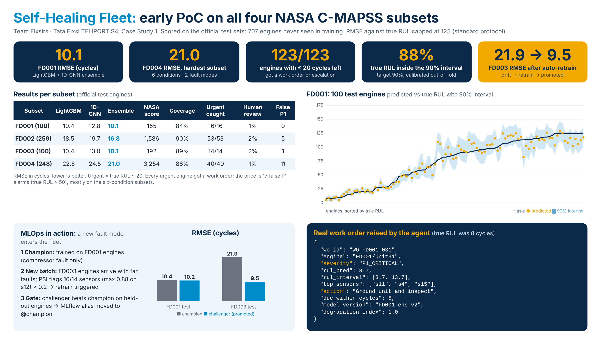

# Self-Healing Fleet: predictive maintenance PoC

Early proof of concept for **Tata Elxsi TELIPORT Season 4, Case Study 1** (Team Elxsirs, AMU).

A closed loop on NASA C-MAPSS turbofan data: sensor stream → clean and normalise → detect degradation →
predict Remaining Useful Life (RUL) with a confidence interval → a rule-based triage agent (no LLM) raises
maintenance work orders, with humans handling only the exceptions. Every run is tracked in MLflow.

## Pipeline

| Stage | What it does |
|---|---|
| Ingest + validate | Loads FD001–FD004; schema and range checks; out-of-range data is flagged and sent to human review |
| Clean | Per-engine interpolation for gaps, Hampel spike filter, EWMA smoothing |
| Normalise | Drops 7 flat sensors; K-Means (k = 6) on operating settings → z-score per regime (fit on train only) |
| Features | Causal rolling mean / std / slope at several scales, plus a **per-engine baseline delta** (sensor minus its own first-15-cycle mean), which removes unit-to-unit manufacturing offsets |
| Anomaly | Isolation Forest trained on the first 25% of each engine's life → degradation index 0–1 |
| RUL | LightGBM (3× sample weight on the last 30 cycles) + regime-gated 1D-CNN with an age channel; blend weight tuned out-of-fold; RUL capped at 125 |
| Confidence | Mondrian conformal 90% interval from out-of-fold errors, binned by predicted RUL (tight near failure) |
| Triage agent | P1 / P2 / P3 / Normal / Human review rules on the interval's lower bound, degradation and disagreement → JSON work orders; thresholds tuned out-of-fold |
| MLOps | MLflow tracking + model registry; PSI drift check → retrain → champion/challenger gate |

## Results (official NASA test sets, never seen in training)

RMSE in cycles against true RUL capped at 125 (standard protocol). "Urgent" = true RUL ≤ 20.
"CV RMSE" is the 5-fold, engine-grouped out-of-fold estimate on the training engines that all modelling choices were based on.

| Subset | Test engines | LightGBM | 1D-CNN | Ensemble | CV RMSE | NASA score | 90% interval coverage | Urgent engines flagged | Human review | False P1 (true RUL > 50) |
|---|---|---|---|---|---|---|---|---|---|---|
| FD001 | 100 | 10.4 | 12.8 | **10.1** | 9.2 | 155 | 84% | 16/16 | 1% | 0 |
| FD002 | 259 | 18.5 | 19.7 | **16.8** | 18.8 | 1,586 | 90% | 53/53 | 2% | 5 |
| FD003 | 100 | 10.4 | 13.0 | **10.1** | 8.4 | 192 | 89% | 14/14 | 2% | 1 |
| FD004 | 248 | 22.5 | 24.5 | **21.0** | 20.4 | 3,254 | 88% | 40/40 | 1% | 11 |

First version of this PoC (test RMSE 12.4 / 18.1 / 12.7 / 24.1, FD004 human review 50%) is the starting point; the numbers above come from the iteration log below.

**Retraining demo** (`retrain_demo.py`): a champion trained on FD001 (compressor fault only) meets FD003 engines with a
new fan fault. PSI flags 10/14 sensors as drifted (> 0.2), a challenger is retrained, and FD003 RMSE drops
from 21.9 to 9.5 with FD001 unchanged (10.4 → 10.2), so it is promoted to `@champion`.

## Iteration log

Every change was judged on out-of-fold RMSE of the training engines (5 folds split by engine, scored at 12 random
truncation points per engine to mimic how NASA truncates test runs). The test sets were run once, at the end, with frozen models.
All runs are in `out/experiments.csv`.

| Step | FD001 | FD002 | FD003 | FD004 |
|---|---|---|---|---|
| Starting features (rolling stats) | 12.3 | 20.9 | 10.9 | 22.0 |
| + per-engine baseline delta | 9.4 | 20.4 | 8.7 | 21.4 |
| + multi-scale deltas | 9.5 | 20.2 | 8.9 | 21.1 |
| + 3× weight on last 30 cycles | 9.5 | – | – | 20.9 |
| + regime-gated CNN blend (final) | **9.2** | **18.8** | **8.4** | **20.4** |

Tried and dropped: running min/max of deltas (worse), other EWMA rates, slow-trend features, regime id as a feature,
per-regime EWMA state, RUL cap 115 or 135 (125 is best), slower or larger LightGBM, a CNN without the age channel
(14.8 vs 12.4 RMSE on FD001), blending that CNN in (hurt), and averaging each engine's predictions over its last 5-50 cycles
(no gain: the errors are persistent per engine, not per-cycle noise).

## Run it

```bash
pip install -r requirements.txt
python run_final.py            # all four subsets: ~8 min from cached out-of-fold predictions, ~50 min from scratch on 2 CPU cores
python run_final.py FD001      # one subset
python retrain_demo.py         # drift → retrain → champion/challenger gate
mlflow ui --backend-store-uri sqlite:///mlflow.db
```

`exp_lib.py` / `experiments.py` / `exp_cnn.py` hold the cross-validation harness used for the iteration log
(`python experiments.py E1_+baseline_delta --fds=FD001,FD004`). Out-of-fold predictions are cached by configuration hash in
`out/cache/final_oof_*.npy` (committed, so unchanged models are never re-cross-validated; change a config and the cache key changes).
`python assets/make_banner.py` redraws the banner above from `out/*.json`.

Outputs land in `out/`: `metrics.json`, `pred_FDxxx.csv` (predictions + intervals + severity per test engine),
`workorders_FDxxx.json` (agent output), `health_FDxxx.csv` (degradation trajectories), `retrain_demo.json`, `experiments.csv`.

## Nightly improvement loop

A scheduled job tries one idea from `nightly/BACKLOG.md` every night at a random time between 00:00 and 04:00 IST.
Rules are in `nightly/PLAYBOOK.md`: the idea is judged on cross-validation only (`nightly/gate.py`: mean RMSE must improve by at least 0.15
with no subset worse by more than 0.3), never on the test sets. Only an accepted idea triggers a full run, a README/banner refresh and a push;
rejected ideas are logged in `nightly/BACKLOG.md` and `nightly/LOG.md`.

## Known limitations / next steps

- FD002/FD004 (six operating conditions) are still the weak spot: RMSE ~17–21 and wide intervals. The agent now flags every urgent engine with almost no human review, but pays for it with false P1 alarms (11 on FD004).
- Test coverage of the 90% interval is 84–90%, a little under target on FD001 and FD004 (small test sets, so some noise).
- The CNN is weaker than LightGBM alone; it only helps as a minor ensemble member.
- Not yet built: Prefect orchestration, Streamlit dashboard, live streaming replay.

## Data

`data/` holds the NASA C-MAPSS Turbofan Engine Degradation Simulation files (Saxena et al., 2008), from the NASA Prognostics
Center of Excellence data repository.
